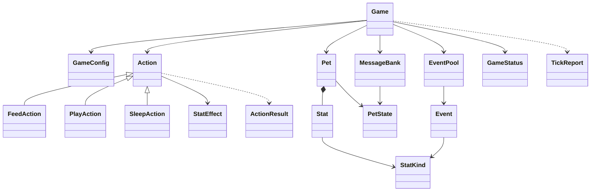

# 🐾 Virtual Pet

A single-player tamagotchi in **Python + Streamlit**. Keep a pet's three vitals
above zero; let any of them hit zero and it runs away.

| Stat        | Restored by | Meaning                        |
|-------------|-------------|--------------------------------|
| Hunger 🍖   | **Feed**    | How well fed the pet is        |
| Energy ⚡   | **Sleep**   | How rested the pet is          |
| Happiness 🎾 | **Play**    | How happy the pet is           |

## Run it

```bash
python3 -m venv .venv
.venv/bin/pip install -r requirements.txt
.venv/bin/python -m streamlit run app.py
```

## Test and lint

```bash
.venv/bin/python -m pytest      # 110 tests, no browser needed
.venv/bin/ruff check .
.venv/bin/ruff format .
```

`tests/test_app.py` drives the real Streamlit script headlessly through
`streamlit.testing.v1.AppTest`, so the UI is covered too.

## Architecture

The rules never import Streamlit; the UI never computes anything. Time is
injected into the engine, which is what makes the whole simulation testable and
lets the clock keep running between reruns.

```
app.py                     Streamlit UI: render + st.session_state + st.fragment
virtualpet/
├── config.py              GameConfig: every tunable number lives here
├── domain.py              StatKind, Stat, Pet, PetState, GameStatus, Defeat
├── actions.py             Action (abstract) + FeedAction / PlayAction / SleepAction
├── events.py              Event, EventPool, the 12-event table
├── messages.py            MessageBank: dialogue per mood, served from a shuffled bag
├── game.py                Game: the engine (clock, decay, events, defeat)
└── text.py                Placeholder rendering, injection-proof
tests/                     110 pytest tests, engine + UI
```



## How time works

`Game.advance(now)` is called from `@st.fragment(run_every=1.0)` and computes
`delta = now - last_advance_at`. Everything is derived from **elapsed seconds**,
not from the number of reruns, so refreshing the browser or a stuttering CPU
never changes the outcome:

- decay is applied proportionally to `delta`;
- events follow a Poisson process (`expovariate`), scheduled from the due time so
  they never drift or burst;
- dialogue is served from a shuffled bag, per mood, so a line never repeats
  until the whole bank has been seen;
- a stall longer than `catch_up_cap_s` (5 min) is forgiven — closing the laptop
  for the night is not the same as ignoring the pet for 30 seconds.

## Tuning

Everything below lives in `virtualpet/config.py`.

| Parameter                        | Value                              |
|----------------------------------|------------------------------------|
| Start / maximum per stat         | 100 / 100                          |
| Decay                            | Hunger 12/min · Energy 10.5/min · Happiness 10/min |
| Feed                             | Hunger **+35**, cooldown 2 s        |
| Play                             | Happiness **+28**, Energy −10, Hunger −5, cooldown 5 s |
| Sleep                            | Energy **+40**, Hunger −6, Happiness −2, cooldown 8 s |
| Events                           | mean interval 35 s (exponential, clamped 6–120 s) |
| Dialogue                         | Thriving 45 s · OK 35 s · Low 20 s · Critical 10 s |
| Mood thresholds (on the worst stat) | Thriving ≥ 70 · Low < 30 · Critical ≤ 12 |
| Action floor                     | 1.0 — an action can never kill      |
| UI tick                          | 1.0 s                              |
| Stall forgiveness                | 300 s                              |

Measured pacing: total neglect kills the pet in **4.4 min on average**
(2.9–6.9), with Hunger, Energy and Happiness each being the first to fail in
roughly a third of runs. A player who reacts can hold out indefinitely.

## Events

Twelve events, four per stat, drawn by weight.

| id              | Title                 | Stat      | Penalty | Weight |
|-----------------|-----------------------|-----------|---------|--------|
| `squirrel`      | Squirrel Sighting     | Hunger    | 18      | 1.0    |
| `empty_bowl`    | The Empty Bowl        | Hunger    | 12      | 1.2    |
| `trash_heist`   | Trash Heist           | Hunger    | 10      | 0.8    |
| `spice`         | The Spicy Counter     | Hunger    | 15      | 0.7    |
| `zoomies`       | 3 AM Zoomies          | Energy    | 20      | 0.8    |
| `thunderstorm`  | Thunderstorm          | Energy    | 16      | 0.9    |
| `neighbor_dog`  | Barking Neighbor      | Energy    | 14      | 1.0    |
| `sugar_crash`   | Sugar Crash           | Energy    | 12      | 0.9    |
| `lost_toy`      | The Lost Squeaky Toy  | Happiness | 16      | 1.0    |
| `ignored`       | Ignored Command       | Happiness | 13      | 1.1    |
| `bored_afternoon` | Same Sunny Window    | Happiness | 11      | 1.2    |
| `mirror_rivalry`| Mirror Rivalry        | Happiness | 15      | 0.7    |

## Design decisions worth knowing

- **Actions never kill.** Negative action effects clamp to `action_floor = 1.0`,
  so defeat can only come from decay or an event. Hammering every button cannot
  end a run (there is a test for it).
- **Events are scheduled, not rolled.** The engine keeps a due timestamp; the
  UI's rerun frequency is irrelevant to how many events happen.
- **Pet names are never formatted.** `{name}` placeholders go through
  `str.replace`, so a pet called `{0}` cannot crash the renderer.
- **The engine is deterministic for a given seed**, which is how the pacing
  numbers above and the tests in `test_game.py` are reproducible.